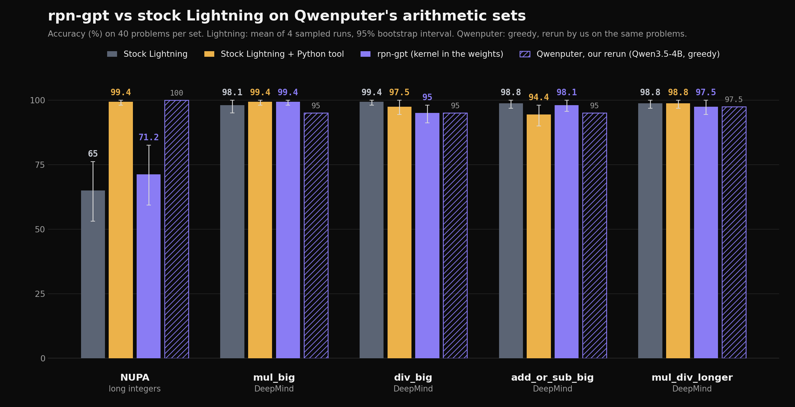

# Arithmetic benchmarks: rpn-gpt vs stock Lightning, on Qwenputer's sets

We ran the arithmetic sets that [Qwenputer](https://github.com/divagr18/qwenputer) reports. We ran them on our model, on stock Nemotron 3.5 Lightning, and on stock Lightning with a Python tool. All three got the same 40 problems per set. We also ran Qwenputer itself, with its own code, on the same problems. Date: 2026-11-06. Hardware: one RTX PRO 6000 (96 GB) per run.



## Results

Each Lightning cell gives the mean of 4 sampled runs (temperature 1.0, top-p 0.95), its 95% interval, and then the score of one greedy run. All numbers are accuracy in %, on 40 problems.

| Set | Stock Lightning, no tools | Stock Lightning + Python | **rpn-gpt-lightning-Forth** | Qwenputer, our rerun (greedy) | Qwenputer, published (greedy) |
|---|---|---|---|---|---|
| NUPA, integers of 3 to 20 digits | 65.0 [53.1, 76.2] / 60.0 | 99.4 [98.1, 100] / 100 | **71.2** [59.4, 82.5] / 82.5 | 100 | 100 (576 problems) |
| DeepMind `mul_big` | 98.1 [95.0, 100] / 97.5 | 99.4 [98.1, 100] / 100 | **99.4** [98.1, 100] / 100 | 95.0 | 97.5 |
| DeepMind `div_big` | 99.4 [98.1, 100] / 97.5 | 97.5 [94.4, 100] / 100 | **95.0** [91.2, 98.1] / 90.0 | 95.0 | 97.5 |
| DeepMind `add_or_sub_big` | 98.8 [96.9, 100] / 100 | 94.4 [90.0, 98.1] / 97.5 | **98.1** [95.6, 100] / 100 | 95.0 | 97.5 |
| DeepMind `mul_div_multiple_longer` | 98.8 [96.9, 100] / 95.0 | 98.8 [96.9, 100] / 92.5 | **97.5** [94.4, 100] / 100 | 97.5 | 100 |

Our model minus the other two conditions, in points. Each difference is paired by problem over the 4 sampled runs, with a 95% bootstrap interval:

| Set | rpn-gpt minus stock | rpn-gpt minus stock + Python |
|---|---|---|
| NUPA | +6.2 [-1.2, +13.8] | **-28.1 [-40.0, -16.9]** |
| `mul_big` | +1.2 [-1.2, +4.4] | +0.0 [-1.9, +1.9] |
| `div_big` | **-4.4 [-8.1, -1.2]** | -2.5 [-6.2, +1.2] |
| `add_or_sub_big` | -0.6 [-3.1, +1.9] | +3.8 [-0.6, +8.8] |
| `mul_div_multiple_longer` | -1.2 [-3.8, +1.2] | -1.2 [-5.0, +1.9] |

What this says, plainly:

- On the four DeepMind sets, all three Lightning conditions are between 94% and 100%. Stock Lightning with thinking already does these sets well by hand. Most differences are inside the noise.
- On NUPA, our model loses clearly to stock Lightning with Python: 71% against 99%. The reason is the machine's size limits. See the next section.
- On `div_big`, our model is 4.4 points below stock Lightning with no tools.
- The kernel in the weights was exact in every turn. In all 1,000 turns of our model, every token that the kernel wrote was equal to the reference machine (`kernel/text_vm.py`). The losses come from the model, and from what the machine can hold. They do not come from wrong kernel outputs.
- Our model seldom uses the machine on these sets. It wrote a Forth block in 20% of the NUPA turns, 12% of `div_big`, 4% of `mul_big`, and in none of `add_or_sub_big` or `mul_div_multiple_longer`. It was trained to use the machine only when it thinks that the problem needs it. On these sets, its scores are mostly its own arithmetic in its thinking.

Qwenputer's published table also has a base Qwen3.5-4B column (48.6, 55, 72.5, 87.5, 90) and a base + Python column (100, 100, 95, 97.5, 97.5). Those are their numbers, on their 4B model. We did not run them.

## Where our model loses, and why

The machine holds integers only. A number has at most 20 digits. For `*` and `mod`, the top operand has at most 10 digits. For `/`, the dividend has at most 10 digits. One Forth block can run at most 196,608 kernel steps.

We put each wrong answer of our model in one bucket, the first that applies:

1. Step cap: the turn reached the step cap.
2. Overflow past 20 digits: an output block showed that error, or the problem has a number or an answer of more than 20 digits.
3. Operand over 10 digits: an output block showed that error, or the problem multiplies two numbers of more than 10 digits each, or divides a number of more than 10 digits.
4. Decimal: the problem has decimal numbers, and the machine has integers only.
5. Model error: anything else. We split it by what happened.

Wrong answers of our model, over the 4 sampled runs (160 turns per set):

| Set | Wrong | Step cap | Over 20 digits | Operand over 10 digits | Decimal | Model error |
|---|---|---|---|---|---|---|
| NUPA | 46 | 0 | 30 | 0 | 0 | 16: 14 wrong by hand (no machine), 1 copied the machine's answer wrong, 1 ran out of turn |
| `mul_big` | 1 | 0 | 0 | 0 | 1 | 0 |
| `div_big` | 8 | 1 | 0 | 0 | 0 | 7: 5 wrong by hand (no machine), 2 wrong programs |
| `add_or_sub_big` | 3 | 0 | 0 | 0 | 2 | 1 wrong by hand |
| `mul_div_multiple_longer` | 4 | 0 | 0 | 0 | 0 | 4 wrong by hand |

In the greedy run, our model got 11 answers wrong: 6 over 20 digits (NUPA), 1 NUPA by hand, 3 `div_big` by hand and 1 `div_big` wrong program.

Problems over a machine limit, of 40 per set: NUPA has 9 with an answer over 20 digits (big products), and 4 of them also multiply two numbers of more than 10 digits. `div_big` has 10 with a dividend over 10 digits. `mul_big` has 30 with decimals, and `add_or_sub_big` has 32.

The details:

- **NUPA.** The 9 problems with answers over 20 digits cost us most of the gap. On them, our model was right in 6 of 36 turns (17%). The model must split the numbers into parts and recombine them, or work by hand. It does this badly. Stock Lightning with Python was right in 35 of 36, because Python has big integers. On the other 31 problems, our model was right in 108 of 124 turns (87%), and Python in 124 of 124. Those 16 misses are model errors: the model added or subtracted numbers of 11 to 20 digits by hand, without the machine, and made a mistake. The machine can do all of them.
- **`div_big`.** One turn tried to divide an 11-digit number by 157014 with a loop that subtracts one step at a time. The loop needed about 490,000 steps, so the turn reached the cap. This is the 10-digit dividend limit pushing the model to a bad workaround. The other 7 misses were model errors.
- **Decimals.** The model scales decimals to integers itself (for example 12.5 becomes 125). On `mul_big` and `add_or_sub_big`, it lost only 3 turns on decimals.

## Method

**Problems.** 5 sets of 40 problems, in [`sets/`](sets/). Each file records its source, sampler and seed.

- The four DeepMind sets are the extrapolate test files of the DeepMind mathematics dataset v1.0 (the original tar file). We took the problems with Qwenputer's own loader (`arith_bench.load_dm`, `n = 40`, seed 0). Their RISC-V eval (`chipformer/rv/evalarith.py --n 40`) takes exactly this sample. We checked that our files equal their loader's output, problem by problem.
- NUPA is the integer add, subtract, multiply-hard and multiply-easy tasks of `test.json` from [HaotongYang/NUPA_text](https://huggingface.co/datasets/HaotongYang/NUPA_text). Qwenputer's NUPA row has 576 problems, from their CHIP-8 release. Their loader gives exactly 576 at 144 per task (8 per digit length, lengths 3 to 20). We took 40 of those 576 with `random.Random(0)`.

**The prompt.** The user message is the question plus Qwenputer's suffix: "Give the final answer as a single number in \boxed{} at the end." It is the same in all conditions.

**The conditions.**

1. Stock Lightning: `nvidia/NVIDIA-Nemotron-3.5-Lightning-30B-A3B-BF16`, served by vLLM 0.29.0. No tools. The system prompt is Qwenputer's line "Do every arithmetic step exactly." Script: [`run_stock.py`](run_stock.py) `stock`.
2. Stock Lightning + Python: the same server. When the model closes a ` ```python ` block, the block runs in a new Python process, as user `nobody`, with a 10 s limit. Its printed output comes back in an ` ```output ` block, as the Forth machine's output does. The system prompt is Qwenputer's tool line, changed for Python. Script: [`run_stock.py`](run_stock.py) `stock_python`.
3. rpn-gpt-lightning-Forth: [`markab/rpn-gpt-lightning-Forth`](https://huggingface.co/markab/rpn-gpt-lightning-Forth) (the round-7 model with the kernel in the weights), on its merged BF16 base `markab/rpn-gpt-lightning`. It ran in vLLM 0.29.0 through `kernel/composite/e2e_vllm.py`, with the card `training/data/cards/reference_v4.txt` as the system prompt. There is no tool and no host loop. The kernel writes every output block. The script checks every kernel token against `kernel/text_vm.py`.
4. Qwenputer: their RISC-V model `divagr1925/Qwen3.5-4B-Qwenputer` (revision `b14ec56`) and their eval code (commit `cb1c969`, `chipformer.rv.evalarith`, condition `rv1`, greedy, 4096 tokens, batch 8). We ran it unchanged on the same 40 problems per set. Its scores use their own scorer.

**Budgets and sampling for Lightning.** These are the model card's settings for all three Lightning conditions. Thinking is on. The thinking closes at 12,000 tokens (1,000 more if a code block is open), and the whole turn stops at 24,000 tokens. The kernel's hidden tokens do not count, but a turn stops at 200,000 tokens in total. We ran 4 sampled runs (temperature 1.0, top-p 0.95) and 1 greedy run (temperature 0).

**Scoring.** We used Qwenputer's exact rule (`arith_bench.strict_pred`), copied in [`score.py`](score.py). The answer is the last `\boxed{}` after the thinking, or else the last number there. Commas and spaces inside the number are removed. The answer must equal the gold answer as an exact fraction, so decimals and fractions compare by value, with no tolerance. A turn whose thinking never ends has no answer. Text inside an output block is not an answer.

**Intervals.** For each problem, we take the mean over the 4 sampled runs. Then we resample the 40 problems 10,000 times (seed 0) and report the 2.5th and 97.5th percentiles.

## What matches Qwenputer exactly, and what does not

Exactly the same:

- The four DeepMind problem sets, and the problems of our Qwenputer rerun.
- The scoring rule, the answer suffix, and the "Do every arithmetic step exactly." line.
- Their model and their code, unchanged, for our Qwenputer rerun.

Approximated or different:

- NUPA: 40 problems drawn from their 576. Their published NUPA number is on all 576, from their older CHIP-8 model. Our rerun of their current RISC-V model got 40 of 40 on our 40.
- Our rerun of Qwenputer scored 2.5 points below their published numbers on four sets (95 against 97.5, and 97.5 against 100). The difference is 1 problem per set. We used their code, at batch 8, on another GPU (RTX PRO 6000 instead of their A10G or L4). Their docs say that the batched decoder is not token-identical to their batch-1 path.
- Lightning thinks, with 12,000 thinking tokens. Qwenputer's Qwen3.5-4B does not think, and has 4,096 tokens. The models are not the same size: Lightning has 30B parameters (3B active).
- Their Python column is base Qwen with their `calc` tool (an expression calculator on the host, in their firmware's output format). Ours is a Python block loop, not a native tool call. Each block runs in a new interpreter.
- Our headline numbers are the mean of 4 sampled runs, because our model card samples at temperature 1.0. Their numbers are greedy. Our greedy numbers are in the table, after the slash.

## Files

| Path | What it holds |
|---|---|
| [`sets/*.json`](sets/) | The 5 problem sets, with source, sampler and seed |
| [`make_sets.py`](make_sets.py) | Builds the sets from the raw DeepMind and NUPA files |
| [`run_stock.py`](run_stock.py) | Conditions 1 and 2 against a vLLM server |
| [`score.py`](score.py) | The exact scorer |
| [`summarize.py`](summarize.py) | Scores, intervals, buckets, `summary.json` and the chart |
| [`box/`](box/) | The shell scripts that ran everything on the GPU machine |
| [`raw/<condition>/<set>.<run>.jsonl`](https://huggingface.co/datasets/markab/rpn-gpt-data/tree/main/bench/raw) | On Hugging Face, not in git (15 MB). Get them with `hf download markab/rpn-gpt-data --repo-type dataset --include 'bench/raw/*' --local-dir .` from the repository root. Every completion, in full. Runs `s0` to `s3` are sampled, `greedy` is greedy. Condition `forth` rows also carry `kernel_exact`. `qwenputer` rows are their records, without token ids |
| [`summary.json`](summary.json) | All numbers on this page |
| [`chart.png`](chart.png), [`chart.svg`](chart.svg) | The chart |

## Run it again

On a GPU machine with the repository, `venv-kernel` (`requirements/vllm-cu130.txt`) and the checkpoints:

```sh
venv-kernel/bin/python bench/make_sets.py DATA_DIR    # DATA_DIR/dm/mathematics_dataset-v1.0/..., DATA_DIR/nupa/test.json
# conditions 1 and 2: serve stock Lightning with vllm serve, set LIGHTNING_URL, LOOP_MODEL, LOOP_TOKENIZER, VLLM_API_KEY
venv-kernel/bin/python bench/run_stock.py stock s0          # s0..s3; LOOP_TEMP=0 for the run called greedy
venv-kernel/bin/python bench/run_stock.py stock_python s0
# condition 3: bench/box/forth_all.sh (one offline vLLM engine per set; needs work/SET.flat.json = the "problems" list of each set)
# condition 4: bench/box/qp_all.sh (Qwenputer's own repo, uv sync --extra hf, their model)
python3 bench/summarize.py --convert --qwenputer QWENPUTER_OUT_DIR
```

`run_stock.py` appends each finished turn to its `.jsonl` file. If a run stops, the same command resumes it.
