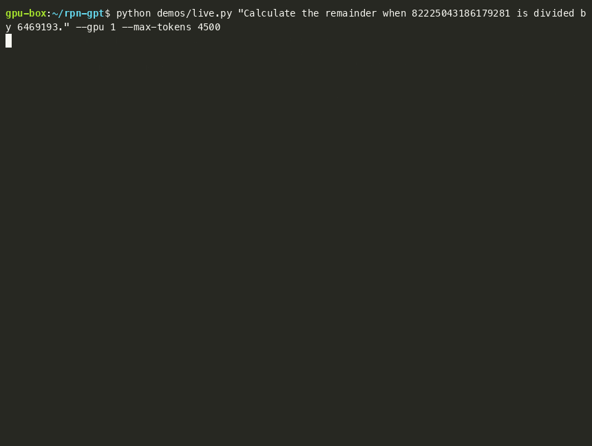

# Demos

This folder shows the model at work. Each transcript is a real rollout from our evaluation files. Long thinking is cut at the `[…]` marks. The one illustration that is not a real run says so.

## The pages

1. [Before and after training](before-after.md). Stock Lightning gets the right output from the machine and does not trust it, or computes by hand when a program is the better way. The trained model writes one short program and reads the answer.
2. [In the weights](in-the-weights.md). The kernel inside the model writes the output blocks. A 136-step loop is 806 visible tokens and 48,968 hidden kernel tokens, exact at every position.
3. [Errors, recovery and limits](errors.md). The fixed error lines, how the model fixes a block, and what fills code memory.
4. [One problem per family](families.md). A complete transcript per problem family, from a big multiplication to Miller-Rabin, and where the model still fails.

## Live recordings

Real requests, recorded in real time with [asciinema](https://asciinema.org) while [`live.py`](live.py) streamed them. Each `.svg` is the finished screen, and each `.cast` plays the stream (`asciinema play demos/live-gpu.cast`). Thinking is dimmed and cut after a few lines. Every answer below is correct, and every output block is equal to the output of the spec for the same program.



- [Big remainder](live-gpu.svg) ([cast](live-gpu.cast)): 82225043186179281 mod 6469193 on one RTX PRO 6000. One block, 297 hidden kernel tokens, 8.0 s.
- [Error, then a fix](live-error.svg) ([cast](live-error.cast)): "Multiply 8579391 by 901918761221." The model pushes the 12-digit number last, the kernel writes the fixed error line, and the model swaps the operands. 2 blocks, 455 hidden kernel tokens, 17.0 s.
- [A loop](live-loop.svg) ([cast](live-loop.cast)): 15 steps of x -> (21066x + 36252) mod 161691 from 43392. One block, 5,194 hidden kernel tokens (about 346 a pass), 45.0 s.
- [The same model on a Mac](live-mac.svg) ([cast](live-mac.cast)): `markab/rpn-gpt-lightning-MLX-4bit` in `mlx_lm.server` on an M4 Max, with the external machine: `live.py --external` runs each block in the spec on the CPU. Thinking budget 3,000 tokens. Correct after one error and a fix, 2,283 tokens in 25.1 s (91 tokens/s). The GPU turns run at about 122 tokens/s, hidden kernel tokens included.

Reproduce on a GPU (server as in [Deploy and test](../playbooks/deploy.md#the-kernel-in-the-weights-from-the-hub)):

```sh
python demos/live.py "Multiply 8579391 by 901918761221." --gpu 0 --svg out.svg
```

On a Mac (`mlx_lm.server --model markab/rpn-gpt-lightning-MLX-4bit --port 8090` in another terminal):

```sh
uv run python demos/live.py "Calculate the remainder when 82225043186179281 is divided by 6469193." --external \
  --base-url http://localhost:8090 --model markab/rpn-gpt-lightning-MLX-4bit --tokenizer markab/rpn-gpt-lightning-MLX-4bit \
  --think-budget 3000
```

## The usual way and this way

The usual way to give a language model exact computation is a tool call. The model writes code, usually Python. Generation stops. A host program runs the code in a sandbox and sends the result back as a new message. The model reads it and goes on.

An illustration of the usual way. It is not a real run, and the format is generic:

```text
assistant:  I will compute it.
            tool_call: python  {"code": "print(8191249343249617212 % 3423811)"}
            ── generation stops; the host runs the code in a sandbox ──
tool:       2599017
            ── the host sends the conversation back; the model reads it again ──
assistant:  The remainder is 2599017.  \boxed{2599017}
```

Here the model writes Forth in its normal text, and the model's own weights run it inside the same generation. There is no tool call, no host, and no round trip. A real block from the in-weights run ([full transcript](in-the-weights.md#the-shortest-turn)):

```forth
82225043186179281 6469193 mod .
```
```output
1290731
```

The model wrote the block. The kernel, a part of the same network, wrote the output block. Nothing outside the model computed it.

| | Tool call (Python, host) | This project (Forth, in the weights) |
|---|---|---|
| Who runs the code | A host program, in a sandbox | The model's own forward passes |
| What the model writes | A tool call in a special format | Plain ` ```forth ` text in its answer, also inside its thinking |
| Round trip | Generation stops, then the context is sent again | None: the output block is the next tokens |
| Language | Python, with libraries | A small Forth: integers, 20 digits, 32 variables, 192 code cells |
| Speed | Microseconds for a loop | One forward pass per kernel step: a 136-step loop took 430 s at batch 1 |
| Exactness | As exact as the interpreter | Exact, and tested at every kernel position against a spec |

We do not claim that this beats tool calling. Tool calling is more general and much faster per step. This project shows what a stack language inside the weights can do with no tool call: the model decides to compute, writes the program, and its own weights compute the answer exactly.
